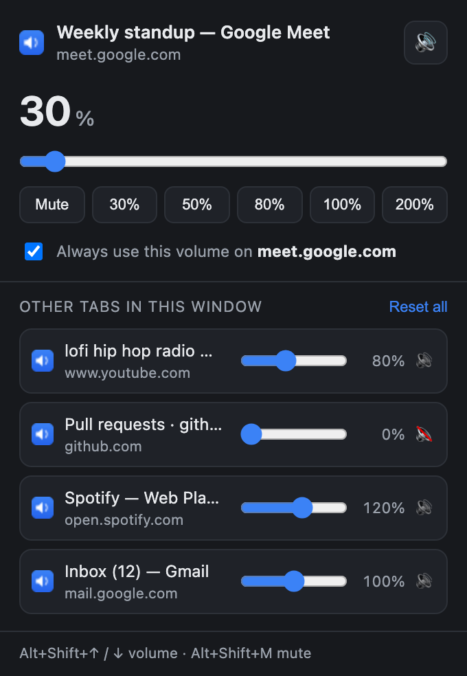

<div align="center">


# Tab Volume Control — Per-Tab Volume Control Chrome Extension

**Set a different volume for every Chrome tab.** Run Google Meet at 30%, YouTube at 80%,
and mute the tab you're browsing in — all at the same time, without touching your system mixer.

[](https://developer.chrome.com/docs/extensions/develop/migrate)
[](LICENSE)
[](#privacy)
[](#contributing)



</div>

---

## The problem

Chrome only lets you mute a tab — all or nothing. So when you're in a meeting with music
on in the background and a dozen noisy tabs open, your only options are the system mixer
(which moves everything at once) or muting things entirely.

**Tab Volume Control gives every tab its own volume slider.**

## Features

- 🎚️ **Independent volume per tab** — 0% to 500%, each tab remembered separately
- 🔊 **Volume booster** — push quiet videos and calls past 100% with Web Audio gain
- 🔇 **Real mute** — mirrors Chrome's native tab mute, so it holds even on DRM video and PDFs
- 🪟 **Control every tab from one popup** — mini sliders for all other tabs in the window, no tab switching
- 📌 **Per-site rules** — save 30% for `meet.google.com` and every future Meet tab starts there
- ⌨️ **Keyboard shortcuts** — `Alt+Shift+↑/↓` for volume, `Alt+Shift+M` to mute
- 🏷️ **Badge readout** — the toolbar icon shows the active tab's level at a glance
- 🎯 **Works where it matters** — Google Meet, YouTube, Zoom Web, Spotify Web, Netflix, Twitch, SoundCloud, Discord Web
- 🔒 **No accounts, no servers, no telemetry** — everything stays in your browser

## Install

### From source (unpacked)

```bash
git clone https://github.com/YOUR-USERNAME/tab-volume-control-chrome-extension.git
```

1. Open `chrome://extensions`
2. Turn on **Developer mode** (top-right toggle)
3. Click **Load unpacked** and select the cloned folder
4. Pin the extension so the badge stays visible

Works in Chrome 111+ and any Chromium browser with Manifest V3 support — Edge, Brave,
Vivaldi, Opera, Arc.

> Tabs opened after install work immediately. Tabs that were already open get the script
> injected automatically, but reload any that misbehave.

## Usage

Click the toolbar icon on any tab. The popup gives you a big slider for the **current**
tab, plus a compact slider and mute button for **every other tab in the window** — so you
can set them all without switching tabs.

### Example: meeting + music + browsing

| Tab | What you do | Result |
| --- | --- | --- |
| Google Meet | Hit the **30%** preset | Voices sit quietly in the background |
| YouTube | Hit the **80%** preset | Music stays present but doesn't drown the call |
| Everything else | Hit **Mute** | No surprise autoplay |

Tick **"Always use this volume on meet.google.com"** and the level sticks for that site —
every Meet tab you open from then on starts at 30% on its own.

### Keyboard shortcuts

| Shortcut | Action |
| --- | --- |
| <kbd>Alt</kbd>+<kbd>Shift</kbd>+<kbd>↑</kbd> | Volume up (active tab) |
| <kbd>Alt</kbd>+<kbd>Shift</kbd>+<kbd>↓</kbd> | Volume down (active tab) |
| <kbd>Alt</kbd>+<kbd>Shift</kbd>+<kbd>M</kbd> | Mute / unmute (active tab) |

Rebind any of these at `chrome://extensions/shortcuts`.

## How it works

The hard part isn't changing the volume — it's making the change *stick*. YouTube and
Google Meet own the `volume` property of their media elements and rewrite it constantly,
so anything that just assigns `video.volume` gets overwritten within seconds.

Instead, this extension runs in the page's **MAIN world** and intercepts
`HTMLMediaElement.prototype.volume`. The site keeps its own volume slider working and
reads back exactly what it wrote — while the real audio output is quietly scaled by your
setting. No fighting, no flicker.

Two paths, picked automatically:

| Level | Mechanism | Why |
| --- | --- | --- |
| **0–100%** | Plain element volume | No Web Audio involved, so nothing can break |
| **Above 100%** | Web Audio `GainNode`, created lazily | Only wired up the first time you actually boost |
| **Mute** | Also mirrors Chrome's native tab mute | Holds on DRM video, the PDF viewer, and pages content scripts can't reach |

Sites that play audio purely through the Web Audio API (browser games, some players)
never touch a media element — for those, `AudioContext.destination` is wrapped with a
master gain node so the same multiplier still applies.

### Project structure

| File | Role |
| --- | --- |
| [`engine.js`](engine.js) | Runs in the page's own JS world. Intercepts the volume property, manages the Web Audio graph, discovers media elements. |
| [`bridge.js`](bridge.js) | Isolated-world content script. Relays state between the service worker and the engine. |
| [`background.js`](background.js) | Service worker. Owns per-tab state, per-site rules, the badge, and keyboard shortcuts. |
| [`popup.html`](popup.html) / [`popup.js`](popup.js) / [`popup.css`](popup.css) | The UI. |
| [`tools/`](tools/) | Test harness, icon generator, screenshot generator. |

Per-tab volumes live in `chrome.storage.session` and last until the tab closes. Per-site
rules live in `chrome.storage.local` and survive restarts.

## Development

```bash
node tools/test-engine.js    # run engine.js against a stubbed DOM (12 checks)
python3 tools/make_icons.py  # regenerate icons/
./tools/make_screenshot.sh   # regenerate docs/screenshot.png
```

`tools/test-engine.js` covers the parts that are easy to get subtly wrong:

- a site's own volume slider still works underneath yours (50% site × 30% yours = 15% out)
- a player that reads `el.volume` and writes it straight back doesn't compound the scaling
- media elements created *after* a level is set still pick it up

No build step, no dependencies, no bundler. Edit a file, hit reload on
`chrome://extensions`.

## Privacy

No analytics, no network requests, no accounts, nothing leaves your machine. The
`<all_urls>` host permission exists solely so the volume script can run on pages that play
audio — which is any of them. Read [`engine.js`](engine.js); it's under 200 lines.

## FAQ

<details>
<summary><b>How is this different from Chrome's built-in "Mute site"?</b></summary>

Chrome's built-in control is binary — full volume or silence. This gives you every level
in between, per tab rather than per site, plus boost above 100%.
</details>

<details>
<summary><b>Does it change my system volume?</b></summary>

No. Nothing outside Chrome is touched, and other tabs are unaffected.
</details>

<details>
<summary><b>Does the volume survive a page reload?</b></summary>

Yes — the setting belongs to the tab, not the page, and is reapplied after each
navigation. Save a per-site rule if you want it to survive closing the tab too.
</details>

<details>
<summary><b>Why is my boosted audio distorting?</b></summary>

Above roughly 200%, an already-loud source clips. That's the audio itself running out of
headroom, not the extension. Back it off toward 150%.
</details>

<details>
<summary><b>Does it work on Google Meet / Zoom / Discord?</b></summary>

Yes — WebRTC calls play through ordinary `<audio>` elements, which is exactly what the
extension hooks. It scales what you *hear*; it never touches your microphone.
</details>

<details>
<summary><b>Will it slow my browser down?</b></summary>

No. Below 100% it's a single property assignment per media element — no audio processing
at all. The Web Audio graph only exists on tabs you've actually boosted.
</details>

## Known limitations

- Chrome blocks extensions from running on `chrome://` pages, the Chrome Web Store, and
  other extensions' pages. Mute still works there via native tab mute; partial volume doesn't.
- Boosting above 100% needs Web Audio. On the rare site serving media cross-origin without
  CORS headers, that connection isn't permitted and the extension falls back to plain
  0–100% control.
- Volumes are per tab, not per window. Duplicating a tab starts the copy at the site
  default (or its saved site rule).

## Roadmap

- [ ] Options page for managing saved site rules
- [ ] Optional per-window master volume
- [ ] Audio equaliser / mono downmix
- [ ] Chrome Web Store release

## Contributing

Issues and pull requests welcome. Run `node tools/test-engine.js` before opening a PR, and
please say which sites you tested against — this extension lives or dies on real-world
player quirks.

## License

[MIT](LICENSE) © MD Riasath Arif Prodhan

---

<div align="center">

**Keywords:** chrome extension tab volume control · per tab volume chrome · volume control
for each tab · chrome volume booster extension · google meet volume control · youtube tab
volume · mute individual chrome tabs · manifest v3 audio extension

⭐ If this saved your ears during a meeting, consider starring the repo.

</div>
